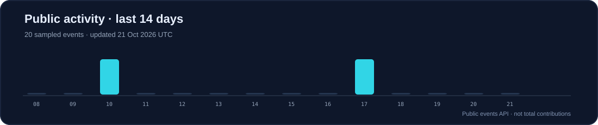

### `> whoami`

**Software Engineer at JPMorgan Chase**, working with Java, Spring Boot, React, and microservices. I enjoy translating complex problems into maintainable full-stack applications, and I bring a strong foundation in algorithms, systems, and applied machine learning.

- 💼 **Engineering:** Enterprise Java applications, Spring Boot, React.js, microservices, and Kubernetes
- 🎓 **Education:** B.Tech, Computer Science & Engineering — VNIT Nagpur (**8.27 CGPA**)
- 🧠 **Competitive programming:** **Codeforces Master (2105)** · AlgoUniversity Fellow (top 2% selection)
- ⚡ **Internship impact:** Automated testing workflows (**80% reduction in testing time**, per my project results), contributed to **10+ Java 11 → 17 migrations**, and developed an NLP-powered chatbot
- 🏆 **Recognition:** Top 3 at JPMorgan Chase Code for Good Hackathon (550+ participants); VNIT Institute Rank 1 in first semester and Rank 2 in first year

Public profile covers my personal work and general experience, not confidential employer systems.

### `> stack --list`

### `> projects --featured`

<table>
<tr><td width="50%" valign="top">
<strong><a href="https://github.com/saket5ingh/Online_Judge">Online Judge</a></strong>  
Online judge supporting C, C++, and Python compilation, execution, and automated grading, with Django APIs and Docker-isolated execution.  
<code>Python</code> <code>Django</code> <code>Docker</code> <code>SQLite</code>
</td><td width="50%" valign="top">
<strong><a href="https://github.com/saket5ingh/-Assignment-Management-Software-System">Assignment Management System</a></strong>  
Assignment tracking application implemented in C.  
<code>C</code> <code>Data Structures</code>
</td></tr>
<tr><td width="50%" valign="top">
<strong><a href="https://github.com/saket5ingh/DownNo2_XGBoost">DownNo2 XGBoost</a></strong>  
High-resolution (100 m) NO₂ air-quality mapping with satellite and ground data. XGBoost model: **R² 0.59**, **MAE 7.69 μg/m³**.  
<code>Python</code> <code>ML</code>
</td><td width="50%" valign="top">
<strong><a href="https://github.com/saket5ingh?tab=repositories">More projects →</a></strong>  
Explore public repositories and ongoing experiments.
</td></tr>
</table>

### `> achievements --highlights`

| Area | Highlight |
| --- | --- |
| Competitive programming | **Codeforces Master — 2105** |
| Academic performance | **VNIT** · 8.27 CGPA · Institute Rank 1 (Semester 1) |
| Hackathon | **Top 3** · JPMorgan Chase Code for Good |
| Fellowship | **AlgoUniversity** · Top 2% selection; top 10 in cohort |

### `> github --live`

**Recently updated public projects** · refreshed daily by GitHub Actions

<!-- AUTO-PROJECTS:START -->
_The scheduled automation will populate this area after its first successful run._
<!-- AUTO-PROJECTS:END -->

<b>About this activity dashboard</b>

The scheduled workflow reads public repositories and recent public GitHub events. This is a limited snapshot of public activity, not a lifetime contribution count. Private contributions and employer repositories are not accessed.

### `> connect --open`

Building useful things, one thoughtful commit at a time.

